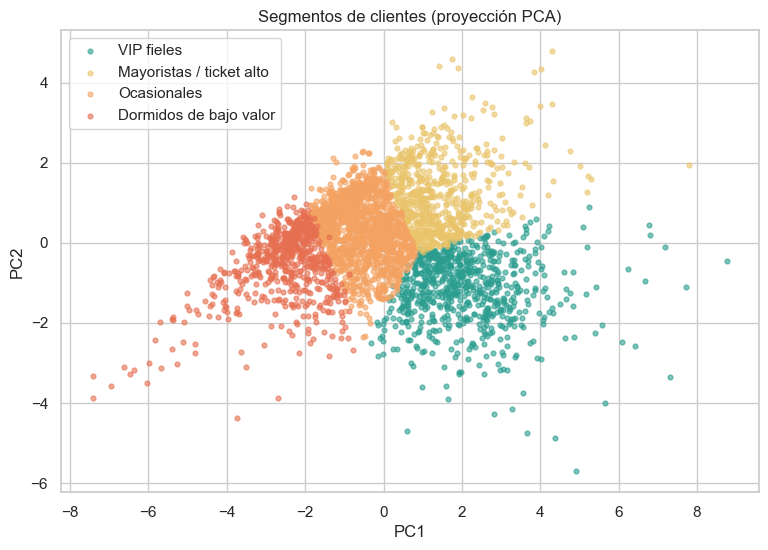
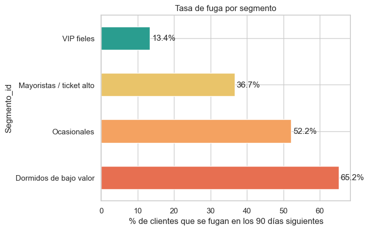
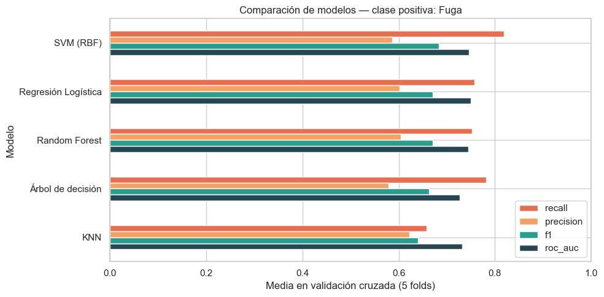
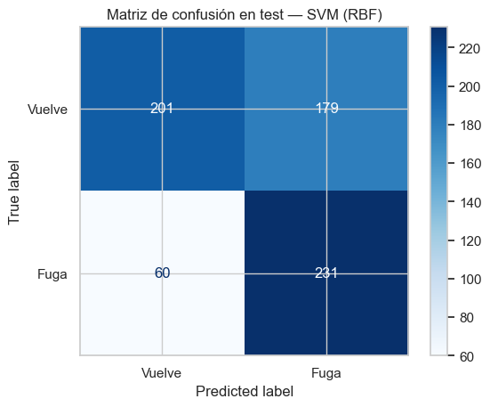

<p align="center">
  
</p>

# 🐾 Qelux · Pipeline de Machine Learning para segmentar clientes y anticipar su fuga

Pipeline completo de **Machine Learning** (limpieza → ingeniería de variables → segmentación no supervisada → predicción de fuga → plan de acción) aplicado a **541.909 transacciones reales** de un e-commerce, con un objetivo concreto: preparar el relanzamiento de **Qelux**, mi marca de productos para mascotas.

> Proyecto desarrollado en el Máster en Data Science e Inteligencia Artificial de **EBIS Business Techschool** (Tema 16 · Caso práctico evaluable).

---

## 🎯 Objetivo

Qelux es una marca real de accesorios premium para mascotas que tengo en pausa. Su producto estrella es un **comedero antivoracidad** de acero y silicona. Antes de relanzarla quería responder, con datos, a tres preguntas:

1. ¿Qué **tipos de cliente** tiene un e-commerce de este tipo?
2. ¿Qué clientes tienen más riesgo de **no volver a comprar** en los próximos 90 días?
3. ¿Qué **acción** conviene aplicar a cada grupo, sin recurrir a descuentos que abaraten una marca de alta gama?

<p align="center">
  
</p>

> ℹ️ Como Qelux aún no tiene histórico propio, uso como **datos proxy** el dataset público [Online Retail (UCI)](https://archive.ics.uci.edu/dataset/352/online+retail): un comercio británico de regalos (2010-2011). Lo que se transfiere es **la metodología**, no los números.

## 🛠️ Herramientas

- **Python** (pandas, NumPy): limpieza e ingeniería de variables
- **scikit-learn**: `Pipeline`, `GridSearchCV`, K-Means, GMM, DBSCAN, PCA, SVM, Random Forest, regresión logística, KNN, árbol de decisión
- **Matplotlib / Seaborn**: visualización
- **Jupyter Notebook** (VS Code)

## 🧱 Arquitectura del pipeline

```
Datos brutos (541.909 filas)
   │  F1 · Limpieza: clientes sin ID, cancelaciones, precios ≤ 0, códigos no-producto, duplicados
   ▼
388.098 filas · 4.322 clientes
   │  F2-F3 · Variables por cliente (RFM+) con fecha de corte 09/09/2011 → target: ¿vuelve en 90 días?
   ▼
3.355 clientes modelables · 43,4 % de fuga
   ├──► F4 · No supervisado: log1p + StandardScaler → K-Means (K=4) vs GMM vs DBSCAN → 4 segmentos
   └──► F5-F6 · Supervisado: Pipeline(log1p → escalado → modelo) + GridSearchCV + StratifiedKFold(5)
             ▼
        F7 · Alerta VIP + plan de acción por segmento
```

## 🔍 Decisiones clave

- **Sin fuga temporal:** las variables se calculan solo con compras anteriores a la fecha de corte y el target solo con las posteriores.
- **Cancelaciones emparejadas una a una** con su compra original, en lugar de borrar solo la línea negativa.
- **Métrica principal: F1 con foco en recall.** Perder a un cliente que se iba a ir cuesta más que mandar una recompensa de más.
- **Línea base con `DummyClassifier`** antes de comparar 5 modelos.
- **Importancia por permutación con ROC-AUC** (con F1 salían valores casi nulos) y contraste con la importancia nativa de Random Forest.

## 📈 Resultados

### 1. Pareto extremo
El **1 % de los clientes (43)** genera el **30 % del gasto**. Perder a uno solo de ellos pesa mucho más que perder a un cliente medio.

### 2. Cuatro segmentos con riesgos muy distintos

| Segmento | % clientes | Tasa de fuga |
|---|---:|---:|
| VIP fieles | 21,6 % | **13,4 %** |
| Mayoristas / ticket alto | 18,7 % | 36,7 % |
| Ocasionales | 40,6 % | 52,2 % |
| Dormidos de bajo valor | 19,0 % | **65,2 %** |

<p align="center">
  
  
</p>

K-Means (silueta 0,229) superó a GMM (0,058); DBSCAN solo encontró un grupo, porque los clientes forman un continuo y no islas separadas.

### 3. Predicción de fuga



Se eligió **SVM (RBF)** por tener el mejor F1 y el mayor recall en validación cruzada (empate técnico con Random Forest y regresión logística). En **671 clientes de test** que el modelo nunca vio:

| Métrica | Validación cruzada | Test |
|---|---:|---:|
| Recall | 0,819 | **0,794** |
| Precisión | 0,586 | 0,563 |
| F1 | 0,683 | 0,659 |
| ROC-AUC | 0,745 | 0,728 |

<p align="center">
  
</p>

El modelo detecta **8 de cada 10 clientes que se van** (231 de 291) y la caída de CV a test es de solo 2-3 puntos: no hay sobreajuste.

### 4. Hallazgo crítico: la alerta VIP
Con el umbral global, el modelo detectaba **0 de 26** fugas VIP: un VIP que se va no lo parece, porque compró hace poco. Sin embargo, el modelo sí los ordena bien por riesgo dentro del segmento. Con una **alerta VIP** (top 20 % de riesgo del segmento, umbral fijado solo con train) se detectan **11 de 26**, y el recall global sube de 0,794 a **0,832**.

## 💡 Plan de acción para Qelux

Qelux se posiciona como alta gama, así que las recompensas refuerzan el producto en lugar de bajar el precio:

| Segmento | Situación | Recompensa (sin descuentos) |
|---|---|---|
| VIP fieles | Pocas fugas, pero las más caras | Alerta VIP, contacto personal y acceso anticipado a novedades |
| Mayoristas | Pedidos grandes y espaciados | Envío gratis en pedidos grandes |
| Ocasionales | El grupo más grande | Puntos de fidelidad para que repitan |
| Dormidos | Una compra, alto riesgo | Inserto antivoracidad de regalo |

## ⚠️ Limitaciones y próximos pasos

- Datos proxy de otro sector y de 2010-2011; una sola fecha de corte; ventana de 90 días corta para mayoristas.
- Predecir la fuga no dice qué incentivo funciona: el siguiente paso es un **test A/B de recompensas por segmento**.
- Reentrenar con datos propios de Qelux y con varias fechas de corte, y fijar el umbral según el coste real de cada acción.

## 📁 Estructura del repositorio

```
├── Qelux_Pipeline_ML.ipynb      # Notebook completo (F0-F7), ejecutado
├── presentacion/
│   └── Qelux_Pipeline_ML_presentacion.pdf
├── img/                          # Logo, fotos del producto y gráficos
├── requirements.txt
└── README.md
```

## ▶️ Cómo reproducirlo

1. Descarga el dataset [Online Retail](https://archive.ics.uci.edu/dataset/352/online+retail) y coloca `Online Retail.xlsx` junto al notebook (no se incluye en el repositorio por su tamaño).
2. Instala las dependencias:

```bash
pip install -r requirements.txt
```

3. Abre `Qelux_Pipeline_ML.ipynb` y ejecuta todo (*Run All*, ≈ 1-2 minutos). Los resultados son reproducibles con `RANDOM_STATE = 42`.

## 🔗 Enlaces

- **Caso de estudio en Notion:** [Ver documentación](https://massive-partner-85f.notion.site/40a0b8a57e6081f3a14ad16fd662d92b)
- **LinkedIn:** [Claudio Abreu Afonso](https://www.linkedin.com/in/claudioabreuafonso/)
- **Otros proyectos:** [github.com/Ca2105](https://github.com/Ca2105)

---

**Autor:** Claudio Abreu Afonso · Data Analyst Jr.
